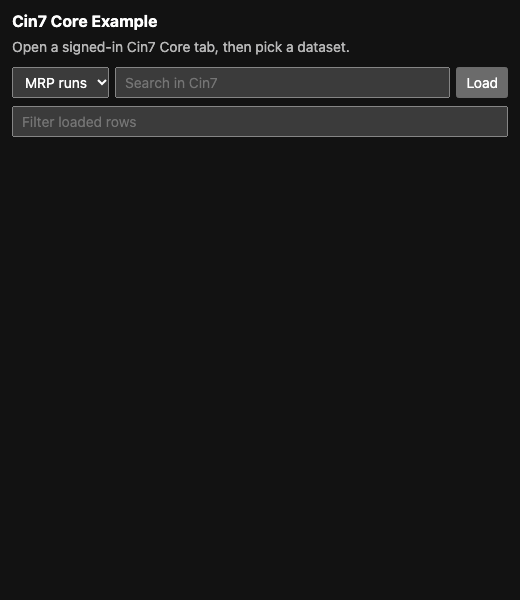
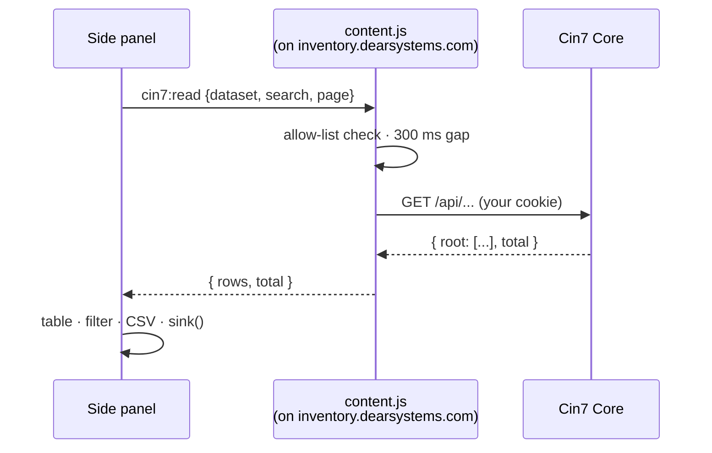
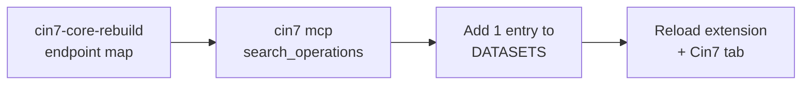

# Cin7 Core extension example

A tiny side panel that reads Cin7 Core through **your own signed-in session**. Copy it, point your agent at it, build what you need.

Invented sample data. Independent example, not affiliated with Cin7.

## Features

| | |
|---|---|
| 📚 Datasets | MRP runs · Products · Suppliers |
| 🔎 Search | Server-side (`search` param) + instant filter |
| 📄 Paging | 25 rows at a time, **Load more** |
| 🧱 Columns | Pick which to show |
| 🔗 Links | Number / Name / SKU open the record in Cin7 |
| ⬇️ Export | CSV of what's on screen |

## How it works

| File | Owns |
|---|---|
| [content.js](extension/content.js) | The **only** code that talks to Cin7. `DATASETS` allow-list, `GET` only |
| [sidepanel.js](extension/sidepanel.js) | UI + `sink()` (the one exit for data, empty by default) |
| [manifest.json](extension/manifest.json) | `sidePanel` + `activeTab` + one host |
| [background.js](extension/background.js) | Icon click → open panel |

## Quick start

| Step | Do |
|:-:|---|
| 1 | `chrome://extensions` → **Developer mode** → **Load unpacked** → [`extension/`](extension/) |
| 2 | Sign in to Cin7 Core, keep that tab active |
| 3 | Click the icon → pick a dataset → **Load** |

| Status | Dataset |
|---|---|
| ✅ Live-tested | MRP runs |
| 🟡 From the map, untested | Products, Suppliers |

## Build on it

Paste into your agent:

> Add a dataset to `extension/content.js` `DATASETS` for <what you want>. Find a GET read endpoint with the `cin7 mcp` server or `../cin7-core-rebuild`. GET only, `textContent` only, no new permissions.

| Tool | Link |
|---|---|
| 🗺️ Endpoint map | [cin7-core-rebuild](https://github.com/fightmilk808/cin7-core-rebuild) |
| 🤖 MCP server + CLI | [cin7-core-cli](https://github.com/fightmilk808/cin7-core-cli) |
| 🧠 Agent skill | [skills/cin7-extension/SKILL.md](skills/cin7-extension/SKILL.md) → copy to `~/.claude/skills/` |

## Rules

| ✅ Do | ❌ Don't |
|---|---|
| `GET` endpoints the map marks read | Same URL with `POST`/`PUT`/`DELETE` |
| `textContent` | `innerHTML` |
| Keep the 300 ms gap, page results | Loop over thousands of records |
| Send data only via `sink()` | Add hosts or permissions unasked |
| Test in your usual browser | Sign in from a second one (1 session per login) |

## Update · Remove

| | |
|---|---|
| Update | `git pull` → reload icon on the card → reload the Cin7 tab |
| Remove | **Remove** on the card. Nothing stored. |

[MIT](LICENSE)
